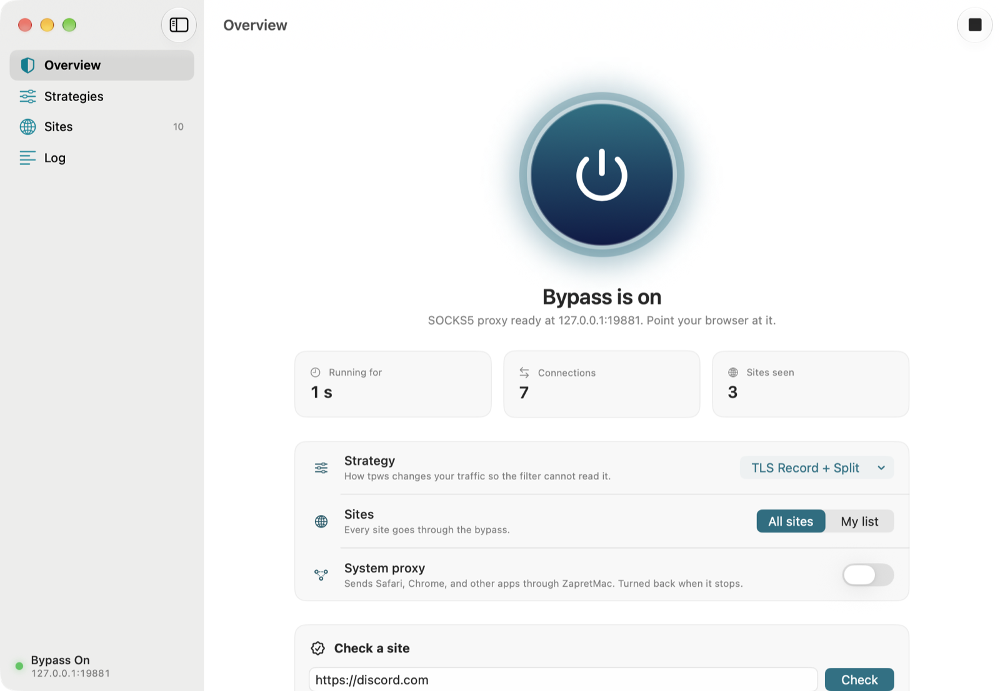
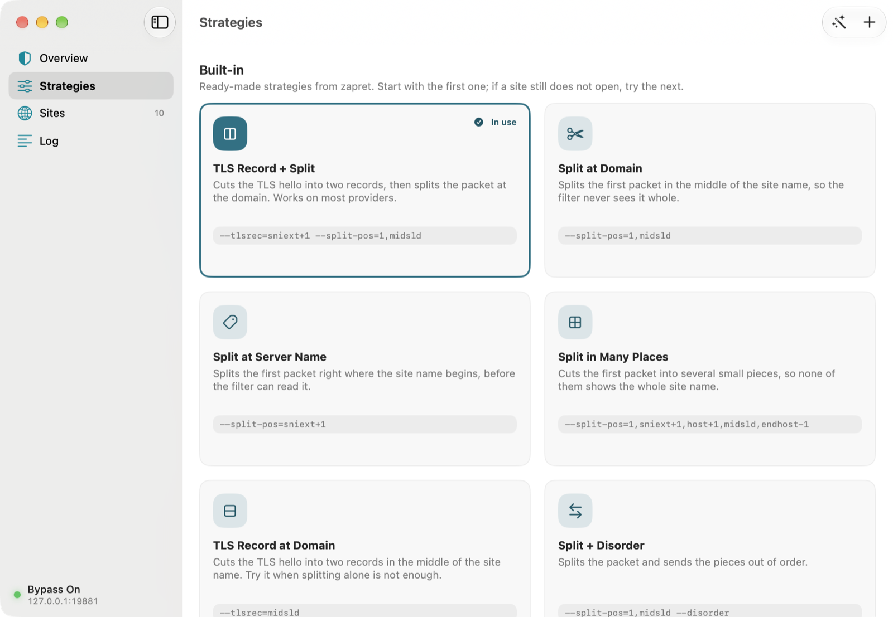
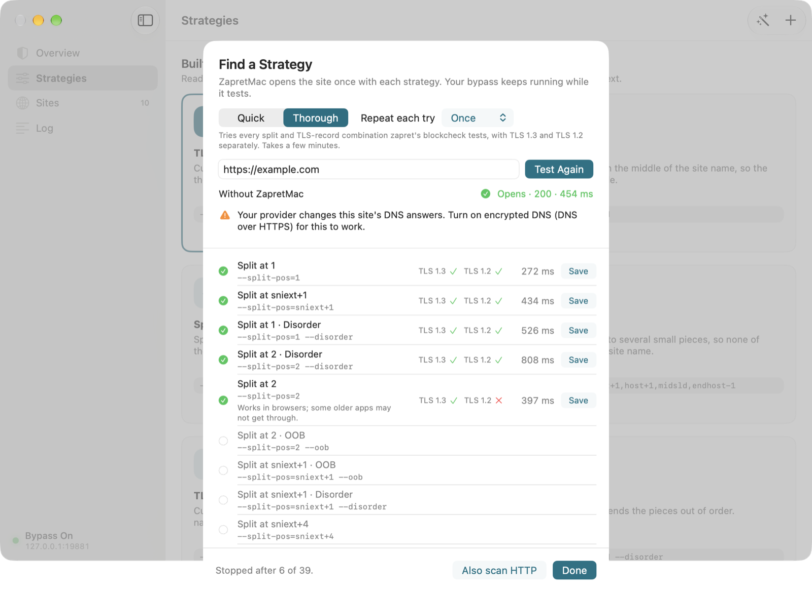
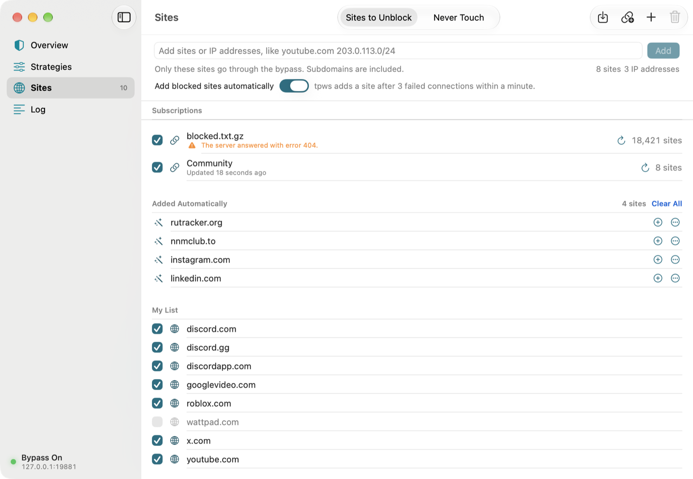
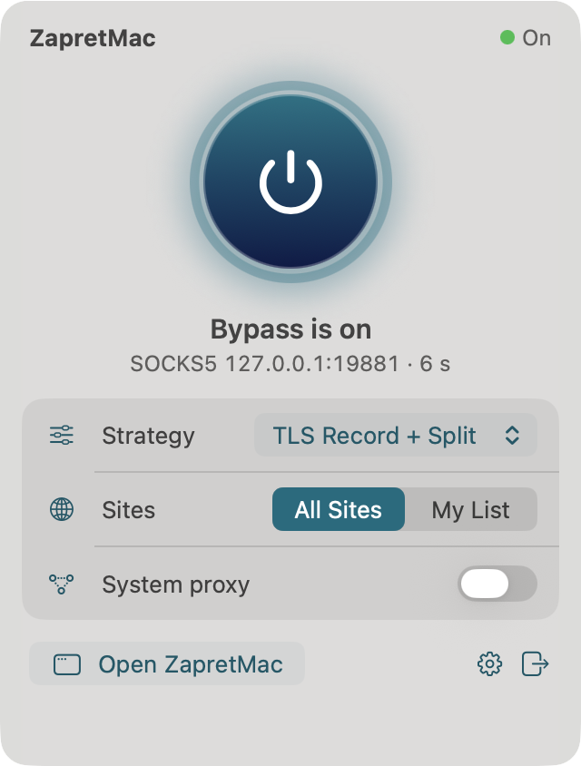
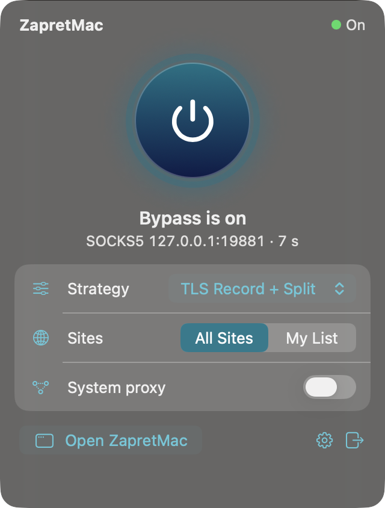

<div align="center">


# ZapretMac

**A native macOS app for [zapret](https://github.com/bol-van/zapret)'s DPI bypass.**
One switch, ready-made strategies, site lists, and a strategy finder, in a SwiftUI app that feels at home on your Mac.

[](#requirements)
[](https://swift.org)
[](LICENSE)
[](#languages)

<picture>
  <source media="(prefers-color-scheme: dark)" srcset="docs/images/overview-dark.png">
  
</picture>

</div>

---

## Contents

- [What it does](#what-it-does)
- [Features](#features)
- [Screenshots](#screenshots)
- [Requirements](#requirements)
- [Build and install](#build-and-install)
- [Getting started](#getting-started)
- [How it works](#how-it-works)
- [Privacy and safety](#privacy-and-safety)
- [Limitations](#limitations)
- [Development](#development)
- [Languages](#languages)
- [Contributing](#contributing)
- [Acknowledgements and license](#acknowledgements-and-license)

## What it does

Some networks block websites with deep packet inspection (DPI): a filter reads the site name in the first packets of a connection and drops or resets it. zapret's `tpws` gets past many of these filters by splitting and reshaping those first packets, so the filter can no longer read the name. The website itself sees a normal connection.

On macOS, using zapret usually means a terminal, config files, and command-line flags. ZapretMac replaces all of that with a native app: it ships `tpws` inside the app bundle, runs it for you, points your Mac at it, and puts everything back when it stops.

## Features

**Turn it on**
- **One switch** in the window, in the menu bar panel, or from any app with a global shortcut. A small on-screen badge confirms the change.
- **Three ways to route traffic:**
  - **SOCKS5 proxy** on `127.0.0.1`, without administrator rights. Point a browser at it.
  - **System proxy:** every app that follows the macOS proxy setting goes through it. With *My list*, a local PAC file sends only the listed sites through `tpws`. The previous proxy setting comes back when ZapretMac stops, quits, or crashes.
  - **Transparent mode:** every app's web traffic goes through `tpws` with no proxy settings at all, over IPv4 and IPv6. It uses a small privileged helper and macOS's own packet filter (see [How it works](#how-it-works)).
- **Share with your network:** phones and other devices on the same Wi-Fi can use the bypass through a SOCKS5 address, with a QR code to scan.

**Choose a strategy**
- **Ten built-in strategies** taken from zapret, each explained in plain words, from a simple split to TLS records, disorder, out-of-band bytes, and HTTP header tricks.
- **Your own strategies** built from `tpws` options in a form: split positions, TLS records, disorder, OOB, ports, protocols, and where changes start and stop. ZapretMac checks the command with `tpws --dry-run` before you save it.
- **Find a Strategy** opens one or more blocked sites with every strategy and ranks what works, fastest first.
  - The *Thorough* scan runs the same `tpws` matrix as zapret's `blockcheck.sh`, testing TLS 1.3 and TLS 1.2 separately and repeating each try if you ask.
  - Before testing, it says what kind of block it found: a DNS block, an IP block, or a filter on the site name.

**Pick the sites**
- **All sites or My list.** *Never Touch* keeps banks, or sites a strategy breaks, out of the bypass.
- **Domains and IP ranges** side by side. Paste many at once, import text files, and undo any change.
- **Subscriptions** to zapret-style host lists and IP lists by URL (gzip too), refreshed daily. Well-known community lists are one click away.
- **Add blocked sites automatically:** `tpws` adds a site to its own list after a few failed connections. You can review the list, move entries, or clear it.

**See what happens**
- **Check a site** opens an address directly and through `tpws`, so you can see whether the strategy helps.
- **Live log** of `tpws` output, filterable by site or errors, with the exact command to copy.
- **Statistics:** how long the bypass has been running, connections, and sites seen.

**A real Mac app**
- SwiftUI on macOS 26, with standard controls, a menu bar item, and full keyboard control: every action has a menu item and a shortcut.
- Light and dark mode, an accent color you choose, and VoiceOver labels.
- Open at login, and start the bypass when the app opens.
- No account, no server, no telemetry.

## Screenshots

<table>
  <tr>
    <td width="50%"></td>
    <td width="50%"></td>
  </tr>
  <tr>
    <td align="center"><sub><b>Strategies:</b> built-in and your own</sub></td>
    <td align="center"><sub><b>Find a Strategy:</b> block diagnosis and ranked results</sub></td>
  </tr>
  <tr>
    <td width="50%"></td>
    <td width="50%" align="center">
      
      
    </td>
  </tr>
  <tr>
    <td align="center"><sub><b>Sites:</b> lists, subscriptions, and IP ranges</sub></td>
    <td align="center"><sub><b>Menu bar panel:</b> light and dark</sub></td>
  </tr>
</table>

## Requirements

- **macOS 26** (Tahoe) or later, on Apple silicon or Intel.
- To build: **Xcode 26** or later (the command-line tools, plus Icon Composer's tools, which come with Xcode).
- For **Transparent mode**: a build signed with an Apple Development certificate. The helper only accepts connections from an app signed by the same team, and an ad hoc signature has no team.

## Build and install

There is no Xcode project; ZapretMac is a Swift package with one build script.

```bash
git clone https://github.com/gorlev/ZapretMac.git
cd ZapretMac
./build.sh --open
```

`build.sh`:

1. builds `tpws` from `Vendor/zapret/tpws` as a universal binary (`make mac`),
2. builds the app and the Transparent-mode helper,
3. compiles the icon and the translations,
4. signs everything with your Apple Development certificate if you have one (ad hoc otherwise),
5. and installs `~/Applications/ZapretMac.app`.

`--open` restarts the app with the new build. Build products stay in `~/Library/Developer/ZapretMac`, outside the repository.

## Getting started

1. **Turn it on.** Click the round switch, or press <kbd>⌘</kbd><kbd>B</kbd>. `tpws` starts as a SOCKS5 proxy on `127.0.0.1`.
2. **Route your traffic.** Turn on *System proxy* on the Overview page so Safari, Chrome, and other apps use it. For apps that ignore the proxy setting, use *Transparent mode* in **Settings → Advanced**.
3. **Check a blocked site.** Type its address under *Check a site*. If it still does not open, use **Find a Strategy** (the magic wand on the Strategies page), save the strategy that works, and select it.

To touch only some sites, switch *Sites* to **My list** and add them on the Sites page.

## How it works

```
                 ┌──────────────── ZapretMac.app ────────────────┐
  Browser ──►    │  SOCKS5 / PAC  ──►  tpws  ──►  reshaped first   │ ──►  Internet
  Any app ──►    │  pf redirect   ──►  (zapret)   packets          │
                 └─────────────────────────────────────────────────┘
```

| Mode | How traffic reaches `tpws` | Needs admin rights |
|---|---|---|
| SOCKS5 | Apps you configure connect to `127.0.0.1:<port>` | No |
| System proxy | macOS proxy settings, set with `networksetup`; with *My list*, a local PAC file | Once, to change the network settings |
| Transparent | `pf` redirects outgoing TCP 80/443 to `tpws` | Once, to approve the helper |

**Transparent mode in detail.** A small helper, `ZapretMacHelper`, is registered with `SMAppService` and approved by you in **System Settings → General → Login Items**. It runs `tpws` as root and loads its rules into its own `pf` anchor, `com.apple/zapretmac`. ZapretMac never edits `/etc/pf.conf`. The rules are removed when the bypass stops, when the app quits, and on the next launch after a crash. The helper accepts connections only from a ZapretMac signed by the same team, and only runs `tpws` with arguments it has checked.

## Privacy and safety

- **Everything stays on your Mac.** Settings and lists live in `~/Library/Application Support/ZapretMac`. Nothing is sent anywhere, and there are no analytics.
- **Network requests the app makes itself:** subscription and suggested-list downloads you add; *Check a site* and *Find a Strategy* opening the sites you type; and, for block diagnosis, a DNS-over-HTTPS lookup of those sites (Cloudflare, Google, or Quad9).
- **Your system is put back.** The previous proxy setting is restored when the bypass stops, the app quits, or on the next launch after a crash. Transparent mode's `pf` rules are removed the same way.
- **`tpws` is built from source.** It is compiled from the vendored zapret sources during the build; the repository contains no prebuilt binaries.

## Limitations

- **TCP only.** zapret's `nfqws`, which handles UDP and QUIC, does not run on macOS. Sites reached over HTTP/3 (QUIC) are not changed. Browsers usually fall back to TCP when QUIC is blocked.
- **Strategies depend on your network.** What works on one provider may not work on another, which is what *Find a Strategy* is for.
- **Automatic site list** works with *My list*, in SOCKS5 or system proxy mode, not in Transparent mode. With *All sites* every site already goes through the bypass, so there is nothing to add.
- **DNS and IP blocks** cannot be bypassed by `tpws`. *Find a Strategy* tells you when that is the problem: use encrypted DNS (DNS over HTTPS) for a DNS block.

## Development

```
Sources/
  ZapretMac/          the app (SwiftUI): pages, engine, menu bar, settings
  ZapretMacKit/       rules and data logic with no UI: tpws commands, pf rules, lists, scans
  ZapretMacHelper/    the privileged helper for Transparent mode (Foundation only)
Tests/ZapretMacKitTests/   unit tests (Swift Testing)
Localization/         translations, one JSON file per language
Icon/                 the app icon (Icon Composer) and accent color
Vendor/zapret/        zapret's sources; tpws is built from here
tools/                self-test, snapshots, layout checks, localization tools
docs/                 product brief, user stories, design notes
```

| Check | Command |
|---|---|
| Unit tests | `swift test --scratch-path ~/Library/Developer/ZapretMac/test-build` |
| Self-test (the app's real functions against a temporary store) | `tools/selftest.sh` |
| Screenshots of every page, light and dark | `tools/snap.sh` |
| Layout grid | `tools/grid-lint.sh` |
| Translations | `python3 tools/l10n.py check` |

Test runs, snapshots, and the self-test use a store in `/tmp` and never touch your real data.

## Languages

English, Türkçe, Deutsch, Español, Italiano, Français, Português (Brasil), and Русский. ZapretMac follows your Mac's language, or the language you choose for it in **System Settings → General → Language & Region → Applications**.

The translations were written to read naturally in each language rather than word for word. Improvements are welcome; see [Localization/BRIEF.md](Localization/BRIEF.md) for the tone and terms.

## Contributing

Issues and pull requests are welcome. Before opening a pull request:

1. Run `./build.sh`; it should build with no warnings.
2. Run the unit tests and `tools/selftest.sh`.
3. For UI changes, run `tools/snap.sh` and check the screenshots in light and dark mode.
4. For new or changed text, run `tools/l10n-extract.sh` and add the strings in every language.

Please describe what a user can now do in the pull request title.

## Acknowledgements and license

ZapretMac is a graphical front end for **[zapret](https://github.com/bol-van/zapret)** by **bol-van**. All of the actual bypass work is done by zapret's `tpws`. ZapretMac is not affiliated with the zapret project.

ZapretMac is released under the [MIT License](LICENSE). zapret, vendored under `Vendor/zapret`, is also MIT-licensed; see [Vendor/zapret/LICENSE.txt](Vendor/zapret/LICENSE.txt).

> [!NOTE]
> ZapretMac is meant to help people reach information on networks that block it. You are responsible for following the laws and rules that apply where you use it.
